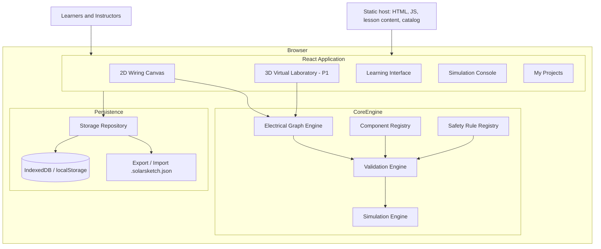

# SolarSketch
## Product Requirements Document (PRD)

**Product:** SolarSketch  
**Category:** Solar PV Education, Virtual Laboratory & Electrical Simulation Web App  
**Platforms:** Web Application (Desktop-first, Responsive)  
**Target Market:** Philippines, with future international expansion  
**Product Type:** Frontend-only web app. No accounts, no login, no backend; all user data stays in the browser (IndexedDB, with a localStorage fallback)  
**Version:** 1.1 — MVP Specification (frontend-only revision)  
**Status:** Proposed

> **Revision 1.1 summary.** The MVP is now a static, frontend-only application.
> - No registration, login, or user accounts. Anyone who opens the app can use it immediately.
> - Projects, lesson progress and challenge attempts are saved in the browser's IndexedDB (localStorage when IndexedDB is unavailable). Small display settings stay in localStorage.
> - Projects can be exported and imported as files so users can back them up, move them between devices, or hand them to an instructor.
> - The Dashboard page is removed. The app opens on the Virtual Lab.
> - No Laravel backend, database, REST API, or subscriptions. The instructor/institution portal and monetization move to a possible future phase that would need a backend.

---

# 1. Product Overview

## 1.1 Vision

SolarSketch is an interactive solar photovoltaic (PV) learning and simulation platform that allows users to understand, design, connect, and simulate complete solar power systems without requiring physical hardware.

The application provides a virtual laboratory where users can:

- Learn about solar power components.
- Understand electrical wiring and connections.
- Build solar power systems using drag-and-drop components.
- Connect electrical terminals using virtual wires.
- Configure hardware specifications.
- Simulate electricity generation and consumption.
- Monitor battery charging and discharging.
- Identify incorrect electrical connections.
- Troubleshoot common solar installation problems.
- Complete guided lessons and practical challenges.

The long-term vision is to become a virtual solar installation training laboratory for individuals, solar technicians, and technical training institutions.

## 1.2 Core Value Proposition

**Learn solar installation through actual interactive practice, not just videos and diagrams.**

Instead of simply showing users how solar components work, SolarSketch allows them to interact with virtual hardware and observe the results of their electrical connections.

## 1.3 Target Users

### A. Beginners and Self-Learners

People interested in learning solar installation without purchasing expensive equipment.

Needs:
- Beginner-friendly lessons.
- Component identification.
- Interactive wiring exercises.
- Visual explanations.
- Instant feedback.

### B. Solar Technicians and Installers

People who want to understand system configurations and improve their technical knowledge.

Needs:
- Hardware specifications.
- Electrical connection validation.
- System configuration exercises.
- Troubleshooting scenarios.
- Advanced simulations.

### C. Students and Engineering Learners

Students studying electrical engineering, renewable energy, or related technical courses.

Needs:
- Electrical principles.
- Series and parallel configurations.
- Voltage and current calculations.
- Practical exercises.
- Performance assessments.

### D. TESDA and Technical Training Institutions

Organizations that provide solar PV installation training.

Needs:
- Learning modules usable in class without creating student accounts.
- Practical exercises and challenges.
- A simple way to collect student work: students export a project file and submit it through the institution's existing channels (LMS, email, shared drive).
- A way to distribute prepared exercises: instructors share a project file that students import.

Instructor dashboards, student accounts and centralized progress monitoring need a backend. They are out of scope for this frontend-only release (see Section 9).

---

# 2. Product Scope

SolarSketch will have five major product modules.

1. Learning Management System
2. Interactive 2D Wiring Simulator
3. 3D Virtual Solar Laboratory
4. Electrical Simulation Engine
5. Assessment and Troubleshooting System

## 2.1 Application Navigation

The app opens directly on the **Virtual Lab**. There is no Dashboard and no login screen.

Main navigation:

- Learn
- Virtual Lab
- Component Library
- My Projects
- Challenges
- Progress
- Settings

There are no account types or instructor-only screens.

## 2.2 No Accounts

- Users never register, log in, or provide personal information.
- All data belongs to the current browser profile on the current device.
- Clearing browser data, using a private window, or switching browsers or devices means starting fresh unless the user exported their projects first.
- The app must explain this clearly the first time a project is saved, and in Settings.

---

# 3. Core Features and Functional Requirements

## Module 1: Learning Management System

Purpose: Provide structured solar installation lessons from beginner to advanced levels.

### Learning categories

**Level 1 — Solar Fundamentals**
- Introduction to solar energy.
- How photovoltaic cells work.
- Solar panel specifications.
- Understanding voltage, current, power and energy.
- AC versus DC electricity.
- Basic electrical safety.

**Level 2 — Solar Components**
- Solar panels.
- Charge controllers.
- Batteries.
- Inverters.
- DC protection devices.
- AC protection devices.
- Electrical cables and connectors.
- Grounding systems.

**Level 3 — Solar System Configurations**
- Grid-tied systems.
- Off-grid systems.
- Hybrid systems.
- Battery configurations.
- Solar panel series connections.
- Solar panel parallel connections.

**Level 4 — Solar Installation Principles**
- Reading electrical diagrams.
- Understanding component datasheets.
- System sizing concepts.
- Protection and isolation.
- Cable sizing principles.
- Installation inspection.
- Testing and commissioning concepts.

**Level 5 — Advanced Solar Systems**
- Multiple MPPT configurations.
- Hybrid inverter systems.
- Battery management systems.
- Generator integration.
- Grid integration.
- Energy management.

### Lesson interface

Every lesson should support:

- Text explanations.
- Illustrations.
- Interactive diagrams.
- Hardware references.
- Short instructional videos.
- Knowledge checks.
- Practical simulator exercises.

### Learning progression

Users must complete prerequisite lessons before accessing selected advanced exercises.

Lesson completion and prerequisite state are stored in browser storage. Users can reset their progress from Settings.

---

## Module 2: Interactive 2D Wiring Simulator

This is the primary MVP feature.

### 2.1 Workspace Layout

The simulator should use a professional electrical-design interface.

**Left sidebar: Component Library**
- Search components.
- Browse categories.
- Drag components into the workspace.

**Center: Wiring Canvas**
- Place components.
- Move and rotate components.
- Connect electrical terminals.
- Draw wires.
- Zoom and pan.
- Select multiple components.
- Delete or duplicate components.

**Right sidebar: Properties Inspector**
- Component specifications.
- Electrical ratings.
- Terminal information.
- Configuration settings.
- Connection information.
- Component documentation.

**Bottom panel: Simulation Console**
- System status.
- Electrical measurements.
- Validation warnings.
- Simulation errors.
- Event logs.

### 2.2 Canvas Capabilities

Required interactions:

- Drag and drop.
- Terminal-to-terminal wiring.
- Positive and negative polarity visualization.
- AC and DC identification.
- Ground connection identification.
- Wire color selection.
- Wire thickness selection.
- Undo and redo.
- Copy and paste.
- Delete.
- Zoom and pan.
- Save and load projects.

### 2.3 Electrical Terminals

Every hardware component must have defined electrical terminals.

Example: Solar Panel

- PV Positive (+)
- PV Negative (-)

Example: MPPT Charge Controller

- PV Positive
- PV Negative
- Battery Positive
- Battery Negative
- Optional Load Positive
- Optional Load Negative

Example: Inverter

- DC Positive
- DC Negative
- AC Line
- AC Neutral
- Protective Earth

The application must understand which terminals are compatible.

A connection should not be treated as valid simply because two components have been visually connected.

### 2.4 Wiring Rules

The wiring engine must recognize:

- Terminal polarity.
- Electrical domain (AC/DC).
- Voltage compatibility.
- Current limits.
- Connection topology.
- Component-specific terminal restrictions.
- Grounding and bonding relationships.

The simulator must detect:

- Reversed polarity.
- Incompatible terminals.
- Disconnected terminals.
- Invalid connections.
- Short-circuit conditions.
- Missing required protective devices.
- Component rating violations.

### 2.5 Project Management

Users can:

- Create a new solar project.
- Save projects (manually with Ctrl+S, and automatically).
- Duplicate projects.
- Rename projects.
- Delete projects (with confirmation).
- Open saved projects from **My Projects**.
- Export a project as a `.solarsketch.json` file.
- Import a project from a `.solarsketch.json` file.
- Export wiring diagrams as an image (P1).

Projects must preserve component configurations, component spec versions, connections, simulation settings, and lesson references.

All projects are stored in the browser (IndexedDB; see Section 11). Sharing happens by exchanging exported files, not through server links.

---

## Module 3: 3D Virtual Solar Laboratory

The 3D laboratory will provide a spatial representation of the same system built in the 2D editor.

### 3.1 Main Experience

Users can:

- View solar panels in a virtual installation area.
- Inspect inverters and batteries.
- Examine hardware components.
- View electrical terminal locations.
- Observe cable routing.
- Rotate and zoom the virtual environment.
- Switch between 2D and 3D views.

### 3.2 3D Environment

Initial environments:

1. Basic solar training laboratory.
2. Residential rooftop solar installation.
3. Off-grid solar installation.
4. Battery and inverter installation room.

### 3.3 Component Interaction

When a user selects a component:

- Highlight the selected device.
- Display its name.
- Show its specifications.
- Highlight available terminals.
- Display connected components.
- Show its current simulation status.

### 3.4 3D Implementation Strategy

Use Three.js with React Three Fiber.

The 3D renderer must consume the same project and simulation data as the 2D canvas.

The initial 3D experience can focus on component placement, inspection, terminal highlighting and visualization.

Detailed electrical behavior must still come from the shared simulation engine, not from the 3D renderer.

---

# 4. Hardware Component Library

The component library is one of the most important foundations of SolarSketch.

Each component must have:

- Component ID.
- Name.
- Category.
- Description.
- Manufacturer.
- Model.
- Specifications.
- Electrical terminals.
- Connection constraints.
- 2D symbol.
- 3D model reference.
- Datasheet reference.
- Supported configurations.

## 4.1 Component Categories

### A. Solar Generation

- Monocrystalline solar panels.
- Polycrystalline solar panels.
- Bifacial solar panels.
- Flexible solar panels.
- Portable solar panels.

### B. Solar Connectors

- MC4 connectors.
- MC4 branch connectors.
- Solar extension cables.
- PV junction boxes.
- Cable connectors.

### C. Charge Controllers

- MPPT charge controllers.
- PWM charge controllers.

### D. Battery Systems

- Lead-acid batteries.
- AGM batteries.
- Gel batteries.
- Lithium-ion batteries.
- LiFePO4 batteries.
- Battery banks.
- Battery management systems.

### E. Inverters

- Off-grid inverters.
- Grid-tied inverters.
- Hybrid inverters.
- Pure sine wave inverters.
- String inverters.
- Microinverters.

### F. DC Protection

- DC circuit breakers.
- DC fuses.
- Fuse holders.
- DC isolators.
- DC surge protection devices.
- Battery disconnect switches.

### G. AC Protection

- AC circuit breakers.
- MCB.
- MCCB.
- RCCB/RCD.
- AC surge protection devices.
- AC disconnect switches.

### H. Distribution Equipment

- DC distribution boards.
- AC distribution boards.
- PV combiner boxes.
- Busbars.
- Distribution panels.

### I. Grounding and Protection

- Grounding rods.
- Grounding conductors.
- Bonding conductors.
- Grounding terminals.
- Protective earth connections.

### J. Electrical Measurement

- Digital multimeters.
- Clamp meters.
- Energy meters.
- Voltage meters.
- Current sensors.
- Power meters.

### K. Electrical Loads

- LED lighting.
- Electric fans.
- Refrigerators.
- Television.
- Desktop computers.
- Air conditioners.
- Water pumps.
- Other configurable electrical loads.

### L. Grid and Backup Integration

- Utility grid.
- Generator.
- Automatic transfer switch.
- Net meter.
- Energy monitoring devices.

## 4.2 Component Data Model

Every component must have a structured specification.

Example:

```ts
interface ComponentDefinition {
  id: string;
  name: string;
  category: string;
  manufacturer?: string;
  model?: string;

  terminals: TerminalDefinition[];

  specifications: {
    nominalVoltage?: number;
    maximumVoltage?: number;
    maximumCurrent?: number;
    ratedPower?: number;
    efficiency?: number;
  };

  capabilities: string[];
  constraints: string[];

  assets: {
    icon2d: string;
    model3d?: string;
    datasheet?: string;
  };

  version: number;
}
```

Component specifications must support units and model-specific properties. Do not assume all devices in the same category have identical electrical ratings.

---

# 5. Electrical Wiring Engine

The wiring engine will be responsible for understanding the electrical relationships between components.

## 5.1 Architecture

Represent the solar system as an electrical graph.

- Nodes represent electrical terminals and connection junctions.
- Edges represent electrical wires.
- Components define the behavior and constraints between their terminals.

Example:

```text
Solar Panel
    |
    | DC
    |
Charge Controller
    |
    | DC
    |
Battery Bank
    |
    | DC
    |
Inverter
    |
    | AC
    |
Distribution Board
    |
    |
Electrical Loads
```

This is a conceptual topology, not a complete installation wiring specification.

## 5.2 Wiring Engine Responsibilities

1. Create connections.
2. Validate terminal compatibility.
3. Determine connected electrical networks.
4. Identify open circuits.
5. Identify short circuits.
6. Check polarity.
7. Validate component compatibility.
8. Calculate electrical properties.
9. Generate warnings.
10. Provide diagnostic explanations.

## 5.3 Connection Validation

Each connection must pass multiple validation stages.

**Stage 1 — Terminal validation**

Are the terminals compatible?

**Stage 2 — Electrical domain validation**

Are the components operating within compatible AC/DC domains?

**Stage 3 — Polarity validation**

Are positive, negative, line, neutral and grounding relationships correct?

**Stage 4 — Rating validation**

Do voltage and current ratings satisfy the applicable component constraints?

**Stage 5 — Topology validation**

Does the overall system contain the required functional connections?

**Stage 6 — Protection validation**

Are required protection and isolation devices represented and correctly specified for the selected system?

A failed validation must return an understandable explanation rather than just an error code.

---

# 6. Electrical Simulation Engine

This is the computational core of SolarSketch.

The initial engine should use deterministic, rule-based electrical models. It should not depend on an LLM to determine whether an electrical connection is valid.

## 6.1 Simulation Capabilities

The engine must support:

- Solar energy generation.
- Solar panel voltage and current.
- Series and parallel configurations.
- Charge controller behavior.
- Battery charging.
- Battery discharging.
- Battery state of charge.
- Inverter conversion.
- Electrical load consumption.
- Energy losses.
- Power balance.
- System warnings.

## 6.2 Solar Generation Model

The preliminary solar generation calculation should consider:

- Installed PV capacity.
- Solar irradiance.
- Module temperature.
- Panel orientation.
- Shading assumptions.
- System performance losses.

A simplified educational model:

\[
P_{PV}=P_{STC}\times\frac{G}{1000}\times f
\]

Where:

- \(P_{PV}\) = estimated PV output power.
- \(P_{STC}\) = installed panel rated power.
- \(G\) = solar irradiance in W/m².
- \(f\) = combined simplified performance factor.

The simplified model must clearly state its assumptions and must not replace a detailed PV performance model.

## 6.3 Battery Simulation

Track:

- Nominal battery voltage.
- Battery capacity.
- State of charge.
- Charging current.
- Discharging current.
- Charge and discharge limits.
- Battery chemistry.
- Efficiency.
- BMS protection events.

The battery model must distinguish between different battery chemistries.

## 6.4 Inverter Simulation

Track:

- DC input voltage.
- DC input current.
- AC output voltage.
- AC output frequency.
- Output power.
- Conversion efficiency.
- Maximum continuous output.
- Overload conditions.
- Low-voltage shutdown.
- Thermal protection events.

## 6.5 Electrical Load Simulation

Users should be able to add appliances to the system.

Each appliance should have:

- Rated power.
- Operating duration.
- Energy consumption.
- Optional startup surge.
- Load priority.

The simulation must determine whether the system can support the selected load based on the configured equipment and operating conditions.

## 6.6 Simulation Time Controls

Provide:

- Start simulation.
- Pause simulation.
- Resume simulation.
- Stop simulation.
- Reset simulation.
- Speed controls.
- Day/night conditions.

Users should be able to observe solar production during daytime and battery discharge during nighttime.

## 6.7 Simulation Console (Measurements)

Display:

- PV generation (W).
- PV voltage (V).
- PV current (A).
- Battery voltage (V).
- Battery state of charge (%).
- Battery charge/discharge power (W).
- Inverter output (W).
- Load consumption (W).
- Energy generated (kWh).
- Energy consumed (kWh).
- System losses (W).

Use charts to visualize system performance over time.

---

# 7. Safety Validation and Error System

Safety is a fundamental product requirement.

SolarSketch is an educational and simulation platform. It must not imply that a successful virtual simulation certifies an actual electrical installation as safe.

## 7.1 Error Classification

**Critical**
- Dangerous electrical topology.
- Severe voltage compatibility violation.
- Reverse polarity in a protected model.
- Short-circuit condition.
- Equipment operating beyond defined absolute limits.

**Warning**
- Missing required protection.
- Potentially undersized conductors.
- Incorrect component selection.
- Incomplete grounding representation.
- Battery configuration concerns.

**Information**
- Optional component not configured.
- Missing component documentation.
- Non-optimal configuration.
- Suggested improvement.

## 7.2 Validation Rules

The validation system must evaluate:

- Maximum PV input voltage.
- Maximum PV input current.
- Charge controller limitations.
- Battery voltage compatibility.
- Battery charging and discharging limits.
- Inverter input and output limitations.
- Conductor ampacity and voltage drop.
- Protective device coordination.
- Grounding and bonding requirements.
- AC/DC isolation requirements.

Rules must be configuration-aware and tied to applicable standards and actual manufacturer specifications.

## 7.3 Safety Feedback

Example messages:

- "The selected PV configuration exceeds the controller's maximum input voltage."
- "The battery configuration is incompatible with the inverter's nominal DC voltage."
- "The selected conductor does not meet the configured current requirement."
- "A required protective device has not been represented."
- "This connection violates the selected component's terminal constraints."

Every safety rule must include:

- Rule ID.
- Description.
- Severity.
- Applicable component.
- Detection conditions.
- Explanation.
- Suggested corrective action.
- Reference source.
- Rule version.

## 7.4 Professional Review

Before releasing advanced safety validation:

- Have the rule library reviewed by a qualified electrical engineer.
- Reference applicable Philippine requirements.
- Validate manufacturer-specific equipment rules against datasheets.
- Maintain versioned standards and rule references.
- Include disclaimers for educational simulations.

The application must not issue a claim of PEC compliance, installation approval, or professional certification based solely on virtual simulation results.

---

# 8. Guided Learning and Challenge System

## 8.1 Guided Exercises

Initial exercises:

1. Identify solar panel terminals.
2. Understand DC voltage and polarity.
3. Explore series panel configurations.
4. Explore parallel panel configurations.
5. Understand charge controllers.
6. Explore battery bank concepts.
7. Understand inverter operation.
8. Identify AC and DC protection equipment.
9. Understand grounding and bonding.
10. Analyze a complete solar system.

Exercises should have prerequisite lessons, objectives, instructions and validation criteria.

## 8.2 Challenge System

Provide practical challenges.

Examples:

**Challenge 1 — Build a Basic Solar System**

Goal: Complete a specified educational solar system using the available component library.

**Challenge 2 — Fix the Incorrect Connection**

Goal: Identify and correct intentionally introduced simulation faults.

**Challenge 3 — Configure a Battery Bank**

Goal: Achieve a specified battery system configuration within defined electrical constraints.

**Challenge 4 — Support Electrical Loads**

Goal: Configure an educational system that can support a specified load profile.

**Challenge 5 — Troubleshoot the System**

Goal: Identify why a system is not producing or delivering the expected power.

## 8.3 Assessment

Each challenge should have:

- Instructions.
- Starting project.
- Expected outcome.
- Allowed components.
- Validation criteria.
- Scoring.
- Attempt history.

Scoring should consider correctness, completion, and understanding—not just whether the user eventually gets the correct answer.

Attempt history and scores are stored in browser storage. Scoring runs entirely in the browser, so it is a learning aid and not a proctored assessment.

---

# 9. Classroom Use Without Accounts

The frontend-only release has no instructor portal, student accounts, or class management. Classrooms can still use the app through project files:

| Need | How it works without a backend |
|---|---|
| Distribute an exercise | The instructor builds a starting project and exports it as `.solarsketch.json`. Students import it. |
| Submit work | The student exports the finished project and submits the file through the institution's existing LMS, email or shared drive. |
| Review a submission | The instructor imports the student's file and runs validation and the simulation locally. Results are deterministic for the same file and rule version. |
| Track progress | Each student's progress is visible only in their own browser, on the **Progress** page. |

### Future phase (requires a backend)

These features were in v1.0 and are deferred until a backend is justified:

- Instructor accounts, classes, student enrollment and assignments.
- Centralized submissions, grading and instructor feedback.
- Institution dashboard, usage analytics and multiple instructors.
- Subscriptions and billing.

If added later, the local project format (Section 11) should remain the import/export and migration format, so existing users can upload their local projects.

---

# 10. System Architecture

## 10.1 Technology Stack

| Layer | Technology |
|---|---|
| Frontend | React + TypeScript (Vite) |
| UI | shadcn/ui + Tailwind CSS |
| 2D Canvas | Custom HTML/SVG canvas (React Flow optional later) |
| 3D Rendering | Three.js + React Three Fiber (P1) |
| State Management | Zustand |
| Charts | Inline SVG / Recharts |
| Persistence | IndexedDB (localStorage fallback); settings in localStorage |
| File exchange | Project export/import as JSON files |
| Hosting | Any static host (e.g., Netlify, Vercel, Cloudflare Pages, S3, DigitalOcean App Platform static site) |

There is no application server, database, authentication service, queue, or object storage.

## 10.2 High-Level Architecture



## 10.3 Architectural Principles

**Shared Simulation Engine**

The 2D and 3D interfaces must use one electrical simulation engine.

**Everything Runs in the Browser**

Validation, simulation, scoring and persistence all run locally in TypeScript. The app must work fully offline once loaded.

**Static Content**

The component catalog, safety rules, lessons and challenges ship with the app as versioned static data. Updating content means deploying a new version of the app.

**Storage Behind One Interface**

All reads and writes go through a single storage repository module. UI code never touches IndexedDB or `localStorage` directly. This keeps the door open to a backend later without changing the UI.

**Separation of Concerns**

The electrical graph, simulation logic, hardware definitions, safety rules and storage must be independent modules.

This makes it possible to upgrade the simulator without rebuilding the entire application.

---

# 11. Local Data Design

## 11.1 Storage Layout

Data lives in an IndexedDB database named `solarsketch`:

| Store / key | Contents |
|---|---|
| `projects` (key = project id) | One full project document per entry |
| `kv` → `meta` | Storage schema version, last opened project, first-run flags |
| `kv` → `progress` | Lesson completion and prerequisite state |
| `kv` → `challenges` | Challenge attempts and scores |

Display settings (theme, grid, snap, wire style, panel layout) stay in localStorage under `solarsketch:settings`, so the theme can be applied before the first paint.

If IndexedDB cannot be opened, the same data is kept in localStorage under `solarsketch:` keys. Data saved by an earlier localStorage-only version is moved into IndexedDB automatically on first load.

## 11.2 Project Document

```ts
interface ProjectDocument {
  schemaVersion: number;      // storage format version, used for migrations
  id: string;                 // UUID
  name: string;
  createdAt: string;          // ISO timestamp
  updatedAt: string;
  ruleSetVersion: string;     // e.g. "1.0.3"
  catalogVersion: string;     // e.g. "2026.11"
  nodes: ComponentInstance[]; // includes the spec values and spec version used
  wires: Wire[];
  settings: {
    clearSky: number;
    speed: number;
  };
  lessonRefs?: string[];
}
```

### Important design decisions

- Use UUIDs for project and component instance identifiers.
- Each project is stored under its own key, so saving one project does not rewrite the others.
- Keep the component catalog separate from project instances. Instances store their own spec values and spec version so older projects stay reproducible.
- Do **not** persist simulation time-series or event logs. They are regenerated by running the simulation.
- Include `schemaVersion` in every document and run migrations on load.
- An exported `.solarsketch.json` file is the same `ProjectDocument`, so import and export need no conversion.

## 11.3 Limits and Failure Handling

- IndexedDB quotas are set by the browser (usually a share of free disk); the localStorage fallback holds about 5 MB. Keep documents compact and avoid storing derived data.
- Every write must handle a `QuotaExceededError`: keep the in-memory project intact, tell the user storage is full, and offer to export or delete old projects.
- Every read must tolerate missing or corrupted data. A corrupted project is skipped, reported in My Projects, and never crashes the app.
- If neither IndexedDB nor localStorage is available (for example, some private-browsing modes), the app still works for the session and shows a banner that work will not be saved.
- Concurrent tabs are notified through a BroadcastChannel when a project is saved or deleted.
- Concurrent tabs: listen for the `storage` event and warn when the open project was changed in another tab.

## 11.4 Import Validation

Imported files are untrusted input:

- Parse safely and validate the shape against the schema before use.
- Reject unknown component types and out-of-range values with a clear message.
- Assign new ids on import so an imported file never overwrites an existing project silently.

---

# 12. Module Interfaces

There is no REST API. The storage repository exposes:

```text
listProjects()                 -> ProjectSummary[]
loadProject(id)                -> ProjectDocument | null
saveProject(doc)               -> void   (throws StorageFullError)
duplicateProject(id)           -> ProjectDocument
renameProject(id, name)        -> void
deleteProject(id)              -> void
exportProject(id)              -> downloads {name}.solarsketch.json
importProject(file)            -> ProjectDocument (validated, new id)

getProgress() / setLessonComplete(lessonId)
getChallengeAttempts(challengeId) / recordAttempt(challengeId, result)
getSettings() / updateSettings(patch)
resetAllData()
```

The interactive simulation never waits on storage. Autosave is debounced and runs after edits settle.

---

# 13. UI/UX Requirements

## Design Direction

The interface should feel like a professional technical training application.

Avoid overly playful or generic AI-generated dashboard aesthetics.

### Design principles

- Professional and minimalist.
- Clear visual hierarchy.
- Technical but beginner-friendly.
- Consistent component illustrations.
- Minimal unnecessary borders.
- Subtle shadows.
- Rounded panels.
- Clear AC/DC color identification.
- Accessible labels and tooltips.

### Suggested visual identity

| Element | Direction |
|---|---|
| Primary | Solar blue |
| Secondary | Renewable energy green |
| Background | Neutral light |
| Dark mode | Charcoal |
| DC Positive | Red |
| DC Negative | Black |
| AC Line | Applicable standard-based identification |
| Ground | Green/yellow where appropriate |

Wire colors are visual conventions only and must not substitute for applicable installation conductor identification requirements.

### Entry point

There is no Dashboard. The app opens on the **Virtual Lab**, showing the most recently opened project, or the sample project on first visit.

### My Projects

Lists the projects saved in this browser, with name, last-updated time and component/wire counts. It provides open, rename, duplicate, delete, export and import. It also shows a short notice that projects are stored only in this browser and recommends exporting backups.

### Progress

Shows lesson completion, challenge attempts and scores from local storage. It replaces the learning-progress and achievement widgets that were planned for the Dashboard.

### Simulator

Prioritize the working canvas over dashboard-style decoration.

The user should have enough space to build and inspect a complete system.

---

# 14. Non-Functional Requirements

## Performance

- Wire interaction should feel immediate.
- Canvas updates should not trigger unnecessary application-wide rerenders.
- The simulation engine should support configurable simulation time steps.
- 3D assets should load progressively.
- Large projects should support efficient rendering.

## Reliability

- Projects autosave (debounced, and when the page is hidden) and on Ctrl+S.
- Undo/redo history is kept in memory for the session.
- Simulation errors must not corrupt saved projects.
- Validation should be deterministic for identical inputs and rule versions.
- Storage-full, unavailable-storage and corrupted-data cases must be handled without losing the open project (Section 11.3).
- Users are reminded to export backups, because clearing browser data deletes their projects.

## Privacy and Security

- No accounts and no personal data collected.
- Project data never leaves the device unless the user exports a file.
- Imported files are validated as untrusted input (Section 11.4).
- No third-party scripts that can read local data. Any analytics must be optional, anonymous and must not send project contents.
- Content Security Policy on the static host.

## Offline

- After the first load, the app should keep working without a network connection. A PWA/service worker is P1.

## Compatibility

- Latest stable Chrome, Edge, Firefox and Safari.
- Desktop-first experience.
- Tablet support.
- Responsive learning interface.
- 3D mode should detect insufficient graphics capabilities and offer a simplified alternative.

## Accessibility

- Keyboard-accessible controls.
- Clear terminal labels.
- Text explanations for visual warnings.
- Color-independent error identification.
- Accessible lesson content.

---

# 15. MVP Scope and Prioritization

The complete product vision is large. The initial MVP should establish the fundamental experience without attempting to model every electrical phenomenon.

## P0 — Required for MVP

- No-login access: the app opens directly on the Virtual Lab.
- Component library.
- Component properties panel.
- 2D drag-and-drop canvas.
- Electrical terminal definitions.
- Terminal-to-terminal wiring.
- AC/DC and polarity validation.
- Series and parallel configurations.
- Basic system topology validation.
- Basic solar generation model.
- Battery state-of-charge model.
- Inverter and load model.
- Simulation console (measurements, validation, event log).
- Save, autosave and load projects in browser storage.
- My Projects: rename, duplicate, delete.
- Export and import projects as `.solarsketch.json` files.
- Guided beginner lessons.
- Basic troubleshooting challenges.
- Educational safety warnings.

## P1 — First Major Update

- 3D virtual laboratory.
- Component inspection in 3D.
- Day/night simulation.
- Advanced battery configurations.
- Manufacturer-specific component profiles.
- Cable sizing and voltage-drop checks.
- More comprehensive safety rules.
- Wiring diagram image export and PDF project export (generated in the browser).
- Offline support (PWA).
- IndexedDB storage with automatic migration from localStorage.

## P2 — Advanced Platform

Status: implemented (frontend only).

- Advanced grid-tied simulation: grid supply, net meter, grid-tied inverter with anti-islanding and export limit, import/export energy and a net-bill estimate.
- Hybrid system simulation: hybrid inverter with grid-assisted, battery/solar and generator-assisted modes and a battery reserve.
- Generator integration: generator with SOC-based auto-start/stop, ATS (main/backup), fuel and run-time tracking.
- Advanced fault scenarios: injectable faults (shading, failed module, breaker trip, BMS cut-off, earth leakage, inverter over-temperature, grid outage, generator failure), field measurements in the inspector, and challenges with hidden faults.
- Advanced 3D cable routing: orthogonal routes through floor trunking, the ceiling tray and down the house wall, with a routed/direct toggle.
- Manufacturer component catalog integrations: users import a JSON catalog built from real datasheets (every spec required, with datasheet link and revision). SolarSketch ships no unverified brand data; imported values are marked unreviewed.
- Internationalization: English and Filipino UI. Lesson text, rule explanations and validation messages stay in English until a qualified reviewer checks the technical translation.

## Future (requires a backend)

- Accounts and cross-device sync.
- Instructor dashboard, classes, assignments and submissions.
- Institutional LMS and analytics.
- Collaborative projects and share links.
- Subscriptions.

---

# 16. Development Roadmap

Suggested timeline for a small development team.

| Phase | Duration | Deliverables |
|---|---:|---|
| Product foundation | 1 week | Architecture, UI, local storage repository |
| Component registry | 1 week | Initial hardware library |
| 2D wiring canvas | 2 weeks | Drag/drop and connections |
| Wiring engine | 2 weeks | Graph and validation |
| Simulation engine | 2 weeks | Solar, battery, inverter, loads |
| Projects and persistence | 1 week | My Projects, autosave, export/import |
| Learning modules | 1 week | Lessons and challenges |
| 3D laboratory | 2–3 weeks | 3D component visualization |
| Testing and release | 1–2 weeks | QA and static-site beta launch |

**Estimated initial development:** Approximately 11–13 weeks. Removing the backend removes database, API, auth and deployment work, and the new persistence phase partly offsets that.

This assumes a focused team, reusable libraries, limited initial component models and an initial 3D scope focused on visualization. A production-grade, standards-reviewed electrical simulator will require additional engineering and validation.

---

# 17. Testing Strategy

## Unit Testing

Test individual simulation and validation functions:

- Voltage compatibility.
- Current limits.
- Polarity.
- Series connections.
- Parallel connections.
- Battery SOC.
- Solar generation.
- Inverter efficiency.
- Load consumption.

## Integration Testing

Test complete component combinations:

- PV panel to charge controller.
- Charge controller to battery.
- Battery to inverter.
- Inverter to AC load.
- PV strings and multiple MPPT inputs.

## Simulation Testing

Test:

- Normal operating conditions.
- Low irradiance.
- High load.
- Battery depletion.
- Reversed polarity.
- Overvoltage.
- Overcurrent.
- Invalid component combinations.
- Missing protection devices.

Expected outputs should be defined using independently reviewed test cases.

## UI Testing

- Drag and drop.
- Terminal selection.
- Wire creation.
- Wire deletion.
- Component configuration.
- Project saving.
- Undo and redo.
- 2D/3D consistency.

## Persistence Testing

- Save, reload and reopen a project: it is identical, including spec versions.
- Autosave after edits; no data loss on tab close.
- Export, then import into a clean browser profile: the project round-trips exactly.
- Import of malformed, oversized or tampered files is rejected safely.
- Storage quota exceeded is handled with a clear message.
- Browser storage unavailable (private mode) shows the "work will not be saved" banner; IndexedDB blocked falls back to localStorage.
- Schema migration from an older `schemaVersion`.
- Two tabs editing the same project produce a warning.

## Professional Validation

Before public release, have the electrical model and safety rule library reviewed by qualified professionals.

---

# 18. Success Metrics

## Product Adoption

Without accounts, metrics come from optional, anonymous, aggregate analytics (no project contents), or from pilot classes and surveys.

- Weekly active browsers.
- Completed lessons.
- Created projects.
- Completed challenges.
- Project exports and imports (a signal of classroom use).

## Learning Effectiveness

- Assessment completion rate.
- Improvement in assessment scores.
- Troubleshooting success rate.
- Average time to complete an exercise.

## Product Engagement

- Average simulator session duration.
- Projects created per user.
- Simulation runs per project.
- Return usage after first session.

Initial product targets should be established after beta testing rather than treated as guaranteed outcomes.

---

# 19. Monetization

Out of scope for the frontend-only release. The app is free to use.

Subscriptions, plan limits and institutional licensing need accounts and a backend. They are deferred to the future phase listed in Section 15. Pricing should be validated through interviews and pilots before that phase starts.

---

# 20. Risks and Mitigation

| Risk | Mitigation |
|---|---|
| Incorrect electrical calculations | Independent engineering review and automated reference tests |
| Incomplete hardware specifications | Versioned manufacturer datasheets |
| 3D development complexity | Begin with a reusable component model library |
| Large simulation scope | Modular simulation engine |
| Poor beginner experience | Guided exercises and contextual explanations |
| Performance issues | Efficient graph and rendering architecture |
| Standards changes | Versioned validation rules |
| Confusion between learning and real installation | Explicit educational-only limitations and professional review |
| Users lose projects when browser data is cleared | First-save notice, export reminders, one-click export in My Projects |
| Browser storage limits | IndexedDB primary, compact documents, no persisted time-series, quota handling |
| No central view of student work | File-based submission workflow (Section 9); backend phase if demand is proven |
| Tampered imported files | Schema validation on import; scoring is a learning aid, not a proctored exam |

---

# 21. Standards and Educational References

The product's educational curriculum and safety validation should be reviewed against relevant Philippine and international references.

1. **TESDA — PV Systems Installation NC II Training Regulations**

   https://tesda.gov.ph/Downloadables/TRs/TR%20-%20PV%20Systems%20Installation%20NC%20II.pdf

2. **IEC 62548-1:2023+AMD1:2025 — Photovoltaic Array Design Requirements**

   https://webstore.iec.ch/en/publication/110893

3. **PNS IEC 62446-1:2020 — PV System Testing, Documentation, Commissioning and Inspection**

   https://bps.dti.gov.ph/

4. **Philippine Department of Energy — Net Metering Guidebook**

   https://legacy.doe.gov.ph/sites/default/files/pdf/renewable_energy/Net-Metering-Guidebook-2022.pdf

These references are starting points for curriculum and engineering review. The applicable editions and requirements must be confirmed before implementation. The simulator must not reproduce copyrighted standards in full without appropriate licensing.

---

# 22. Final Product Direction

SolarSketch should evolve through three stages:

**Stage 1 — Virtual Learning Laboratory**

Users learn components, create connections and simulate basic solar systems.

**Stage 2 — Professional Training Simulator**

Users practice advanced system configurations, electrical validation and troubleshooting.

**Stage 3 — Institutional Solar Training Platform (requires a backend)**

Training centers and schools use SolarSketch for lessons, practical exercises, assessments and student progress tracking. Stages 1 and 2 are delivered as a frontend-only app with local storage. Stage 3 is the point where accounts and a backend are introduced.

## Final Product Statement

SolarSketch is a web-based interactive solar photovoltaic learning platform that combines 2D electrical wiring, 3D virtual hardware, electrical simulation, guided lessons and practical troubleshooting.

Its primary purpose is to make solar installation knowledge more accessible through realistic virtual practice while promoting proper electrical safety and professional installation standards.

**Core product principle:**

Build the electrical engine first, make it interactive through 2D, and extend the same engine into 3D.

The result should be more than a solar wiring diagram tool. It should be a virtual laboratory where users can learn, experiment, understand and improve their solar installation knowledge.